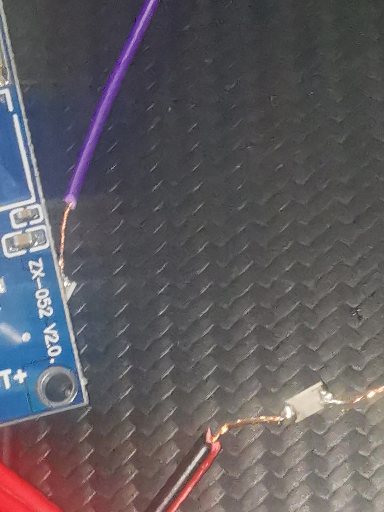
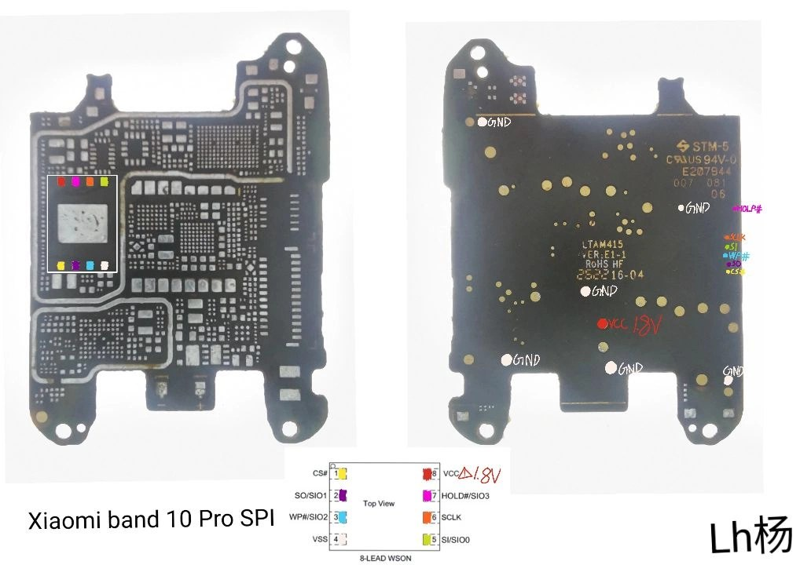
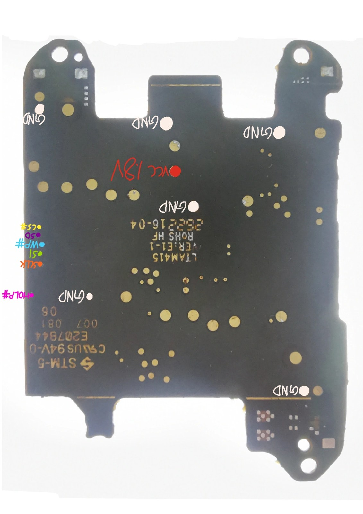

# 我把手环 10 Pro 拆了：从一颗 1.8V 的 SPI NAND 里，把文件系统捞了回来

> 拆机 · 飞线 · 电平转换 · Radxa 直读 · ECC 纠错 · YAFFS2 / ROMFS 还原
> 一台刷 AP 刷砖的手环，最后的贡献是一份 544 MiB 的 raw 镜像。

这台小米手环 10 Pro 的结局有点惨：某次刷写 **AP（应用处理器）固件**失败之后，它就再也开不了机了——彻底变砖。

但变砖也有变砖的用法。反正救不回来了，不如拆了，把里面的东西全读出来看看。于是它成了我做过的下手最狠的一次"遗体研究"：开盖、吹下芯片、飞线、做电平转换、用 Radxa 小板把整片 NAND 读出来，最后把 Vela 系统里的文件系统完整还原、逐文件校验通过。

这篇就是整个过程的手记。能帮到同样在折腾的人，就最好。

| 项 | 内容 |
|---|---|
| 设备 | 小米手环 10 Pro（内部代号 **p67**，主板丝印 LTAM415 / 252216-04） |
| 系统 | 小米 **Vela OS**（NuttX 系 RTOS，BES 平台 SoC） |
| 芯片 | **Dosilicon DS35M4GB-IB** · 4 Gbit SPI NAND · 1.8V · WSON-8（6×8 mm） |
| 读取平台 | Radxa Zero 3W（Rockchip RK3566，40-Pin 的 SPI3_M1） |
| 电平方案 | DCDC 5V→1.8V 供电；SI/SO 各串 2.2 kΩ 做 1.8V⇄3.3V 适配 |
| 镜像 | `DS35M4GB_miband10pro_full_dump_20261010_544MiB.bin`（570,425,344 B） |
| 还原 | BCH ECC 纠错 → YAFFS2 用户数据 → 离线 rootfs **5959 文件**全部校验通过 |

---

## 一、为什么会有一台变砖的手环躺在拆解台上

先交代一下事故经过。这块手环之前在一次 **AP 固件刷写**中失败——AP 就是应用处理器那部分系统，相当于手环的"主系统"。刷写中途失败后设备就再也起不来了，连充电开机都救不回来。

所以它到我手上时，已经是一台"确定报废"的设备。这样反而没有心理负担：不需要考虑保修（拆过必然失效）、不需要担心弄坏（已经坏了），可以放心大胆地拆。

我的目标也很明确：

1. 把 NAND 完整读出来——**raw 镜像**，包括主区和 spare（OOB）区；
2. 搞清楚分区和固件格式（AP / BL2 / Factory / OTA / Recovery 各是什么）；
3. 用 spare 区里的 **BCH ECC** 纠错，还原 **YAFFS2** 用户数据分区，重建整个可浏览的文件系统。

当时没料到的是，这活儿的难点一个接一个：芯片是 **1.8V** 的逻辑电平，和开发板的 3.3V GPIO 完全不是一个世界；WSON-8 这种无引脚封装焊盘小得可怜；NAND 读出来还不能直接用，得先做 ECC……

## 二、拆机：手环没你想的那么好拆

手环这玩意儿防水做得相当扎实，开盖需要耐心：

1. **加热后盖**，让胶软化，沿边缘慢慢撬开——动作要轻，屏幕排线（FPC）就在附近；
2. 断开排线，取出主板；
3. 定位那颗 Flash：**WSON-8** 封装，6×8 mm，没有引脚，全靠底部焊盘贴在板上；
4. **热风枪**（约 330~350℃、低风速）把芯片吹下来，清理焊盘残锡；
5. 芯片拆下来之后没法直接插，我把它固定到一个 SOP-8/WSON 转接板上，再焊上杜邦线引出来。



## 三、先认识一下这颗芯片：DS35M4GB-IB

芯片来自**东芯半导体（Dosilicon）**，是 4 Gbit 的 SPI NAND。数据手册在仓库的 `datasheet/DS35X4GBXXX_rev07.pdf`（Rev.07，2025-03-14），参数以它为准。

型号本身就能读出不少信息（DS35X4GB 命名规则）：

| 字段 | 值 | 含义 |
|---|---|---|
| 系列 | 35 | SPI NAND |
| 组织/电压 | **M** | 1.8V，Quad SPI x1/x2/x4（`Q` 是 3.3V 版） |
| 容量 | 4G | 4 Gbit |
| 温度等级 | I | 工业级，-40℃ ~ 85℃ |
| 封装 | B | WSON 6×8 mm（8 引脚） |

关键参数（数据手册 FEATURES / Device Parameters）：

| 参数 | 值 |
|---|---|
| 存储组织 | 512M×8 bit 主区 + 32M×8 bit spare（合计 **544 MiB**） |
| 页 / 块 | (2048+128) B/页，64 页/块，(128K+8K) B/块 |
| 块数 | 4096 |
| VCC | 1.7 ~ 1.95 V（M 版） |
| SPI 模式 | Mode 0 / Mode 3 |
| 接口 | 标准 / Dual / Quad SPI（x1/x2/x4） |
| 串行时钟 | 83 MHz（1.8V）/ 104 MHz（3.3V） |
| 页随机读取 | 25 µs（无 ECC）/ 130 µs（有 ECC） |
| 页编程 / 块擦除 | 300 µs / 2 ms（Typ） |
| ECC | 片上 8-bit ECC，默认开启，可用命令启停 |
| 寿命 | 80K P/E cycles；10 年数据保持（8bit/512B ECC） |

注意那个 **1.8V**——`M` 版就是 1.8V 供电的版本。这直接决定了后面整个接线方案。

引脚定义（WSON-8 顶视图，见 `images/wson8_pinout.jpg`）：

| Pin | 名称 | 方向 | 说明 |
|---|---|---|---|
| 1 | CS# | I | 片选（低有效） |
| 2 | SO / SIO1 | O | 串行数据输出（MISO） |
| 3 | WP# / SIO2 | I | 写保护（低有效） |
| 4 | VSS | - | 地 |
| 5 | SI / SIO0 | I | 串行数据输入（MOSI） |
| 6 | SCLK | I | 时钟 |
| 7 | HOLD# / SIO3 | I | 暂停（低有效；悬空会挂起，后面有教训） |
| 8 | VCC | - | 1.8V 电源 |

## 四、不敢怼焊盘？那就量测试点

WSON-8 焊盘间距太小，直接往焊盘上怼线风险很高。好在 PCB 背面往往有和这些信号**等电位**的过孔和焊盘，把它们找出来就是一条安全得多的路。

做法很简单，全靠万用表：

1. 断电，用**通断档（蜂鸣）**，从已知网络（VCC、GND，以及芯片焊盘）出发，逐个探测主板背面的候选点，把所有 ≈0Ω 的**等电位测试点**找出来；
2. 上电，用直流电压档复核：VCC 网络实测 **1.8V**，GND 网络 0V；
3. 把结果按主板俯视图画成一张**测试点网络图**，每个点标上信号名和实测电位。





| 网络 | 测试点 | 实测电位 | 备注 |
|---|---|---|---|
| VCC | 红色标注点 | 1.8V | Flash 供电轨 |
| GND | 多处白色标注点 | 0V | 共地参考 |
| CS# / SI / SO / SCLK | 见测绘图 | - | 与芯片对应引脚等电位 |
| WP# / HOLD# | 见测绘图 | 1.8V（板级上拉） | 读操作无影响 |

## 五、接线：1.8V 的世界和 3.3V 的世界

### 供电：先把 5V 降到 1.8V

Radxa 的 40-Pin 上有 5V 输出（Pin2/Pin4），但芯片要 **1.8V**。用一个带数显的可调 DCDC 降压模块，先把输出空载调到 1.8V（万用表确认），再接芯片——别问我是怎么知道要先调准再上电的。

```
Radxa Zero 3W 40-Pin            DCDC Buck 模块               DS35M4GB
┌──────────────┐  5V      ┌──────────────────┐  1.8V   ┌──────────────┐
│  Pin2 / Pin4 ├─────────▶│  IN   ▏   OUT    ├────────▶│ VCC   (Pin8) │
│   (5V)       │          │  输出调至 1.8V    │         └──────────────┘
└──────────────┘          └─────────┬────────┘
    GND (Pin6) ─────────────────────┴──────────────────▶ VSS (Pin4)
```

### 电平：2.2 kΩ 电阻，一个不太"正规"但管用的办法

这里是最容易翻车的地方。Flash 是 **1.8V 逻辑域**，Radxa 的 GPIO 是 **3.3V 域**（上限 3.63V）。直接连会出两个问题：

- 3.3V 灌进 1.8V 芯片的输入，**过压**，可能损坏器件；
- 1.8V 的高电平达不到 3.3V 输入的高电平阈值，**读不到数据**。

正规做法是上双向电平转换芯片（TXS0108E / SN74LVC2T45 之类）。但我手头方案更朴素：**SI、SO 两条线各串一颗 2.2 kΩ 电阻**。

- **SI（MOSI，3.3V → 1.8V）**：3.3V 输出串 2.2 kΩ 后进 1.8V 输入。电阻把电流限制住，配合输入端 ESD 保护二极管钳位，到达引脚的电压就被压在安全范围；
- **SO（MISO，1.8V → 3.3V）**：1.8V 输出串 2.2 kΩ 后进 3.3V GPIO，限制电流，顺便压一压长飞线上的振铃。

说句实话，串阻方案只适合**低速、对信号完整性要求不高**的场景——我这个工程读取时钟压到几 MHz 以内，跑得稳稳的。要是想跑高速，还是老实上电平转换芯片。

### 完整接线表

引脚号对照 Radxa 官方硬件接口说明（RK3566，SPI3 M1 复用）：

| 信号 | Flash Pin | Radxa 引脚 | 中间元件 | 方向/备注 |
|---|---|---|---|---|
| CS# | 1 | Pin24（SPI3_CS0_M1 / GPIO4_C6） | - | SoC → Flash，片选 |
| SO（MISO） | 2 | Pin21（SPI3_MISO_M1 / GPIO4_C5） | 2.2 kΩ | Flash → SoC |
| WP# | 3 | 接 1.8V | - | 禁用写保护（读操作无影响） |
| VSS | 4 | GND（Pin6） | - | 共地 |
| SI（MOSI） | 5 | Pin19（SPI3_MOSI_M1 / GPIO4_C3） | 2.2 kΩ | SoC → Flash |
| SCLK | 6 | Pin23（SPI3_CLK_M1 / GPIO4_C2） | - | 时钟 |
| HOLD# | 7 | 接 1.8V | - | **必须拉高**，否则挂起 |
| VCC | 8 | DCDC 输出 1.8V | - | 供电 |

两个坑提前说：**HOLD# 别悬空**，否则芯片直接挂起，什么都读不出来；飞线尽量短、扎整齐，串扰这东西很玄学，降速永远是最快的解药。

## 六、Radxa Zero 3W 上把 SPI 打开

Radxa 的 SPI 默认是关的，得先开 overlay：

```bash
sudo rsetup
# Overlays → Manage overlays → 勾选 SPI/spidev 相关 overlay
# （Zero 3W 的 overlay 在 /boot/dtbo/，比如 spi3-m1-spidev）
```

重启后确认节点：

```bash
ls -l /dev/spidev*
```

一般是 `/dev/spidev0.0` 或 `/dev/spidev3.0`，以你板子实际枚举为准。

## 七、读片：整整 544 MiB

读取流程用的是标准 SPI x1：

1. 先发 `9Fh` **READ ID** 确认身份——DS35M4GB 返回 `E5h 64h`（数据手册 Table 3.2 写得明明白白）；
2. 逐页读取：`13h` + 3 字节行地址（块 RA[17:6] + 页 RA[5:0]）把页面载入片上缓存，等 tR（有 ECC 时 130 µs），再发 `03h` + 2 字节列地址 + 1 个 dummy，一口气读出 **2176 B**（2048 主区 + 128 spare）；
3. 4096 块 × 64 页循环下来，拼出整片镜像。

仓库里放了参考脚本 `scripts/read_spi_nand.py`（也可用 `flashrom -p linux_spi:dev=/dev/spidevX.Y,spispeed=4000`，SPI NAND 记得确认支持列表）。

校验这一步不能省：

- 连读两遍，`md5sum` 完全一致；
- 大小 = 4096 × 64 × 2176 = **570,425,344 B（544 MiB）**，和数据手册容量严丝合缝（含 spare）；
- 原始 NAND 源哈希（记录在还原产物的 `verification.json`）：

```
bc0c07a021200962c357dc58d3da0230b8259233eb4dfdfa7eebd7be92585670
```

产物：`DS35M4GB_miband10pro_full_dump_20261010_544MiB.bin`。

## 八、拿到 raw 之后：分区、ECC、还有救回来的文件系统

raw 镜像到手，真正的活才刚开始。

### 分区长什么样

从还原出来的固件设备文档（`devices.json` / `dev.md`）能拼出完整的分区/设备节点布局：

| 设备节点 | 挂载点 | 文件系统 | 状态 |
|---|---|---|---|
| `/dev/ap` | -（分区） | - | AP 系统分区，OTA 以 32 KiB 块写入 `vela_ap.bin` |
| `/dev/bl2` | -（分区） | - | 第二阶段启动/升级分区，写入 `vela_bl2.bin` |
| `/dev/resource` | `/resource` | ROMFS | 只读资源分区，正常系统与 Recovery 都挂它 |
| `/dev/nand_data` | `/data` | **YAFFS2** | 主数据 NAND 分区（本次还原主体） |
| `/dev/nand_nv` | `/wasted_nv` | YAFFS2 | BL2 挂的 NAND 持久区；这台机器上全是 `0xFF`（已擦除） |
| `/dev/nv` | `/misc` | littlefs | **NOR** 分区，没拿到（逻辑偏移 `0xFE0000`，长 `0x20000`） |
| `/dev/mode` | `/mode` | littlefs | **NOR** 分区，没拿到（逻辑偏移 `0xFC0000`，长 `0x20000`） |
| `/dev/bes_flash` / `/dev/bes_nand` | - | - | BES 平台底层 Flash/NAND 驱动接口 |

也就是说，NAND 上跑着 YAFFS2 的数据分区和 ROMFS 资源分区，另外还有一颗 **NOR** 管 nv/mode——那颗我没拆，算是这次留下的遗憾之一。

### 为什么非要 ECC 不可

NAND 的特性是：放久了或者擦写多了，个别 bit 会**悄悄翻掉**。所以每页 spare 区里都带了 BCH ECC 校验数据。我的流程是：按页把 spare 里的 ECC 拆出来，用软件 **BCH 解码（`bchlib`）** 把主区的位错误纠正掉，得到 ECC-corrected 镜像（`romfs_ecc_corrected/`）——不纠正直接解析文件系统，大概率会在半路遇到一堆"文件名都读不对"的诡异错误。

### 从 YAFFS2 里捞出来的用户数据

对 `/dev/nand_data` 做 YAFFS2 解析，Vela 系统的用户数据就还原出来了：

```text
app/           预装应用：com.shell.liangyi（桌面）、health、home、notifications、
               nfc、perpetual_calendar、quickapp、sport、system、training、
               watchface/builtin（含 AOD）、weather …
apps.json     应用清单
fitness/       健康数据：daily/p0·p32、sport、view、research …
gps/           GPS 记录
misc/         系统杂项
persist.db    持久化数据库（24 KB）
power_event/  开关机/充电事件
usage_stats/  使用统计
vela_ota.bin   OTA 升级包（内含 OTA 阶段固件）
p67-full-ap/  watchface-backup-ap.bin（AP 固件备份，内含 AP /etc ROMFS）
```

### 各阶段固件，一个都没跑

从 YAFFS 数据 + ECC 纠正结果里，把四套固件全找齐了，连各自内嵌 `/etc` ROMFS 的偏移都定位到了：

| 镜像 | 来源 | 构建版本 | 内嵌 /etc ROMFS 偏移 / 大小 |
|---|---|---|---|
| `vela_ap.bin`（AP） | `p67-full-ap/watchface-backup-ap.bin` | 3.101.036（`CONBINE_LTALM078_T3.101.036`） | 12,433,648 B / 23,440 B |
| `vela_ota.bin`（OTA 包） | `/data/vela_ota.bin` | 3.101.043 | 452,800 B / 5,136 B |
| `vela_factory.bin`（Factory） | `romfs_ecc_corrected/prebuild/` | 3.101.043 | 2,318,212 B / 3,072 B |
| `vela_recovery.bin`（Recovery） | `romfs_ecc_corrected/prebuild/` | - | 847,108 B / 2,864 B |

有个挺有意思的细节：AP 固件存在两份字节级略有差异的副本（`watchface-backup-ap.bin` 和 `full-ap-recovery/vela_ap.bin`），但**内嵌的 `/etc` ROMFS 字节完全相同**；Factory/OTA 的 `build.prop` 和参考文档里的样本版本不一样，还原时我保留的是实际镜像内容。

### 完整离线文件系统

最后把各阶段固件 + 用户数据拼成 p67 AP 命名空间的离线视图：

```text
rootfs/
  etc/        AP 固件内嵌 ROMFS 的 6 个原始配置与脚本
  resource/   主 ROMFS 的 5814 个文件
  data/       YAFFS 最新状态的 139 个文件
  misc/       /dev/nv 挂载点（NOR 分区尚缺）
  mode/       /dev/mode 挂载点（NOR 分区尚缺）
  ota/        /data/ota.zip 挂载点（快照中无 ota.zip）
  watchface/ font/ i18n/   Recovery 阶段 ROMFS loop 挂载点（依赖 /resource/*.bin）
  wasted_nv/  BL2 备用挂载点（NAND 对应区域全 0xFF）
  dev/ proc/ tmp/   运行时命名空间，保留空目录
```

缺的东西也如实记了（`missing_sources.json`）：NOR 的 `nv`/`mode` 分区（`/misc/factory.prop`、`/mode/*`）、BL2 完整镜像、`/data/ota.zip`、Recovery loop 挂载用的 `/resource/*.bin`。运行时由 NuttX 驱动注册的设备节点（`/dev/*`）不实例化为普通文件——这些是拿不到的，不硬凑。

## 九、成果：全都验证过的那种

`filesystem_completed_verified/verification.json` 里的结论：

| 项 | 结果 |
|---|---|
| rootfs 文件 / 子目录 / 字节数 | **5959 / 337 / 219,512,486 B** |
| resource（ROMFS）/ data（YAFFS） | 5814 文件 / 139 文件 |
| 阶段还原 | AP 6 · OTA 6 · Factory 4 · Recovery 3 · BL2 3（共享文件，哈希与文档一致） |
| 文档比对 | 17 份精确匹配 · 3 份源缺失 · 3 份共享文件哈希一致 · 2 份镜像版本不同保留原样 |
| 校验 | 所有输出哈希已验证 · 固件 ROMFS 元数据校验和有效 · 输入源哈希保持 |
| 参考文档 | 32 份 |
| 缺失源 | 10 项 |

**全部 5959 个 rootfs 文件与源字节一致**，原始 ECC / YAFFS / ROMFS 输入文件一个没动。

成果归档：

| 归档 | 内容 |
|---|---|
| `DS35M4GB_miband10pro_full_dump_20261010_544MiB.zip` | 全片 raw 镜像（单 `.bin`，570,425,344 B） |
| `yaffs_data_restored.zip` | `/data` YAFFS2 用户数据还原 |
| `filesystem_completed_verified.zip` | 完整离线 rootfs + `file_manifest` / `SHA256SUMS` / `mounts.json` / `verification.json` / `tools/` |

数据归档体积不小（raw 就 544 MiB），没塞进本仓库 zip，建议丢 Git LFS 或 Release 页。

## 十、想自己复现？

```bash
# 依赖：bchlib、numpy、pyelftools（Python 3）
python3 complete_filesystem.py <ecc_yaffs目录> <system文档目录> --out <新输出目录>
```

脚本和解析器在 `filesystem_completed_verified/tools/`（`complete_filesystem.py`、`inventory_contents.py`）。组装过程只读和复制文件，绝不修改源镜像——数据完整性是底线。

## 附：参考资料

- 数据手册：`datasheet/DS35X4GBXXX_rev07.pdf`（Dosilicon，Rev.07，2025-03-14）
- Radxa Zero 3W 硬件接口说明（40-Pin 定义）：<https://docs.radxa.com/zero/zero3/hardware-design/hardware-interface>
- Radxa rsetup（Overlay 管理）：<https://docs.radxa.com/en/template/sbc/os-config/rsetup>
- Radxa Zero 3W mraa / SPI：<https://docs.radxa.com/en/zero/zero3/app-development/mraa>
- flashrom：<https://flashrom.org>

---

一点感想收尾：这次最值的部分，不是数据本身，而是把"1.8V 的芯片接 3.3V 的板子"这种教科书上说不该干的事，用两颗电阻真跑通了；以及亲眼看到 NAND 的 ECC 机制在 raw 镜像里是怎么一环扣一环的。手环本体已经救不回来了，但它的"遗产"——一份完整的固件和文件系统——算是留下来了。

**LICENSE**：MIT（见 `LICENSE`）。固件内容归原厂商所有，仅作研究用途。
