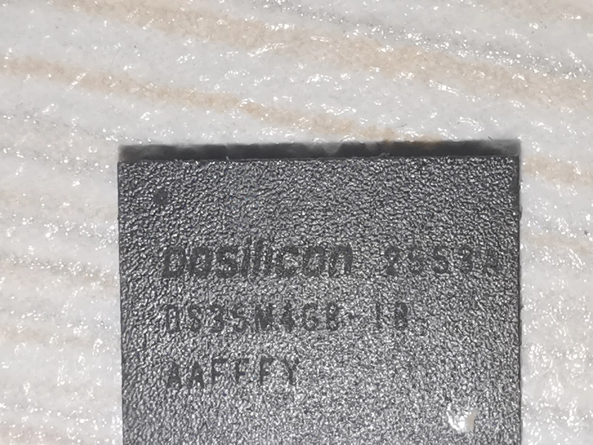
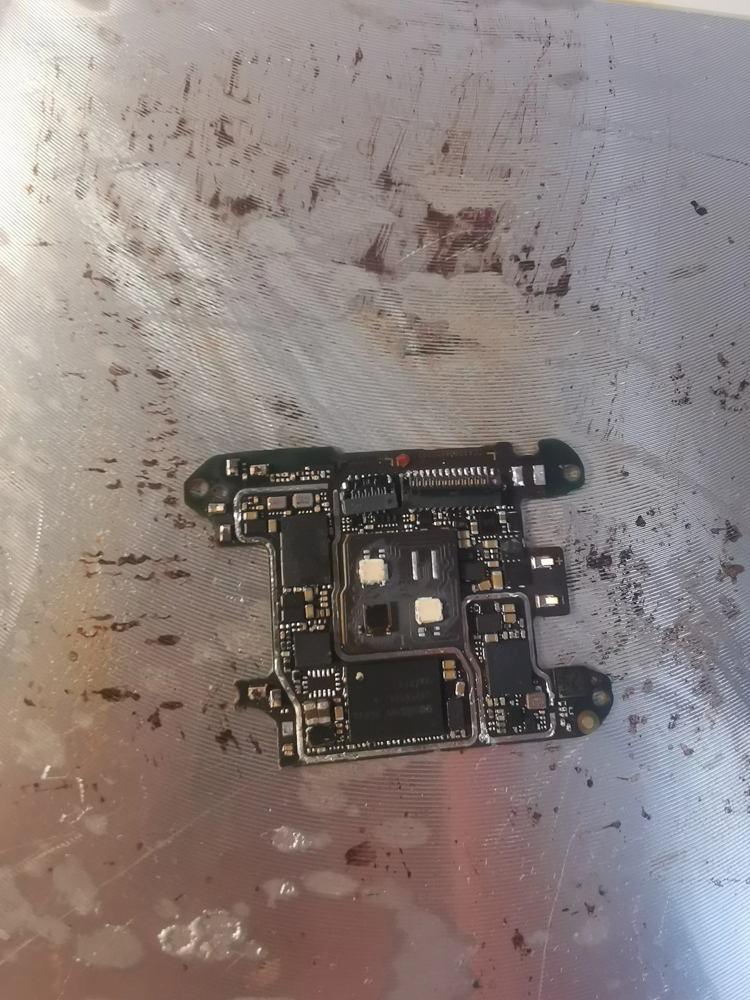
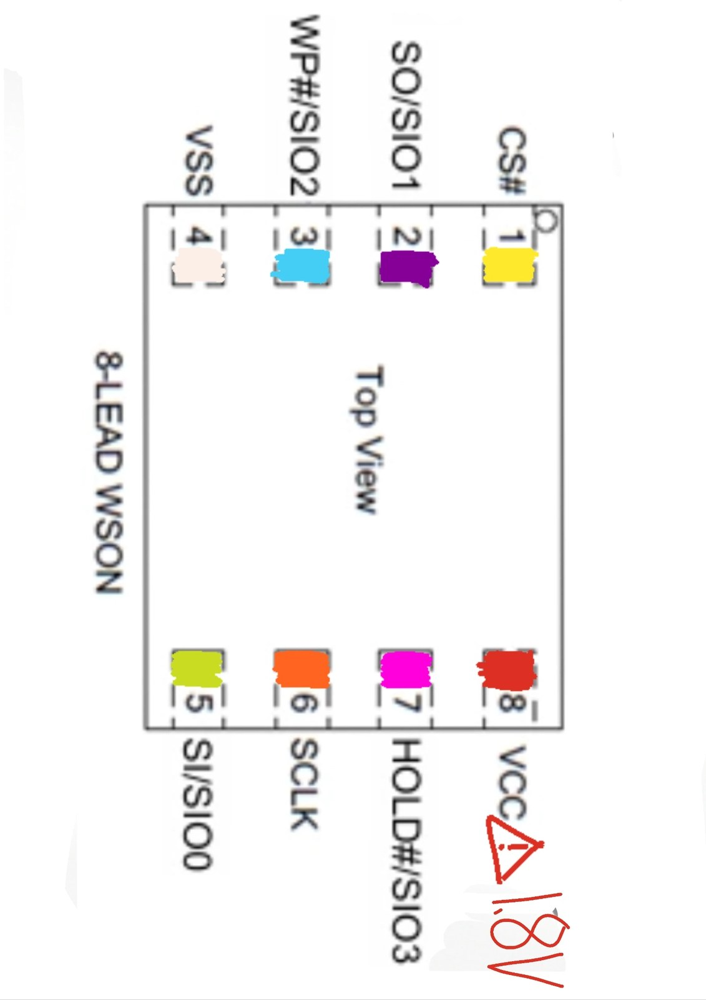
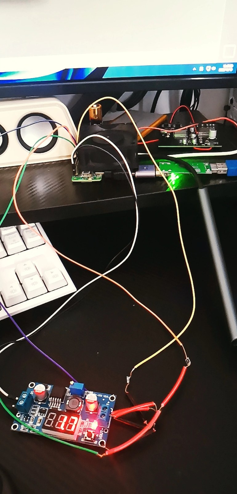
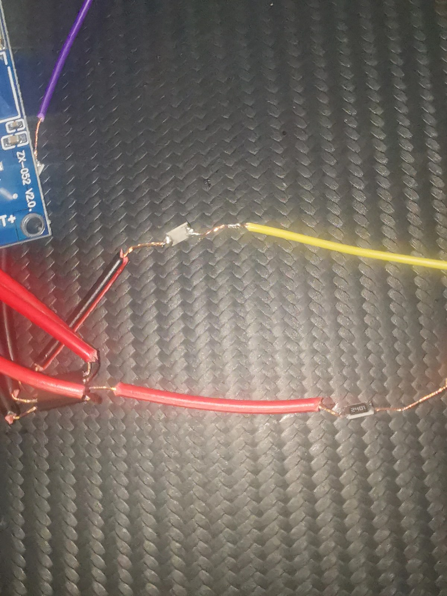
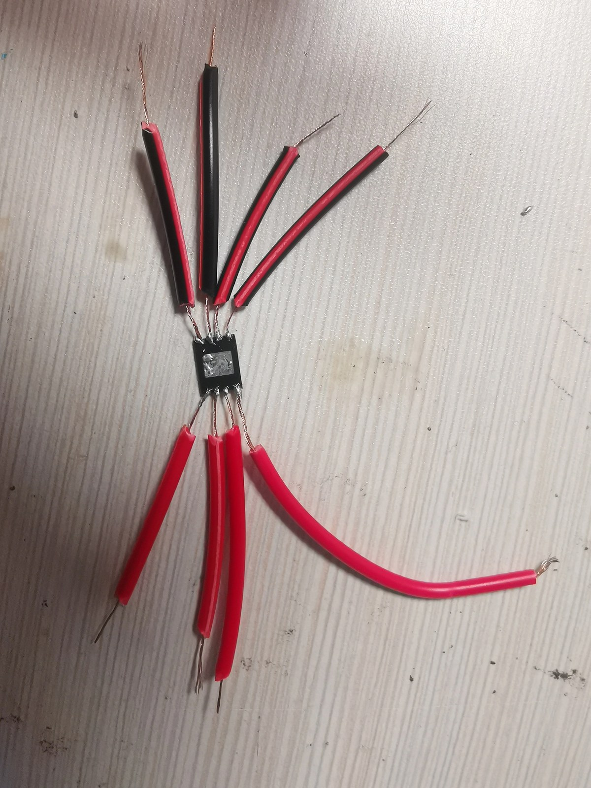

# 小米手环 10 Pro（P67）拆解实录：SPI NAND 固件提取与文件系统还原

> 拆机 · 测试点测绘 · 1.8V/3.3V 电平适配 · Radxa Zero 3W SPI 直读 · BCH ECC 纠正 · YAFFS2 / ROMFS 还原
> 设备来源：一台刷写 AP（应用处理器）固件失败而变砖的手环 10 Pro。

| 项 | 内容 |
|---|---|
| 设备 | 小米手环 10 Pro（内部代号 **p67**，主板丝印 LTAM415 / 252216-04） |
| 系统 | 小米 **Vela OS**（NuttX 系 RTOS，BES 平台 SoC） |
| 样本来源 | 刷写 **AP（应用处理器）固件失败变砖**，无法开机，作为拆解研究样本 |
| 目标芯片 | **Dosilicon DS35M4GB-IB** · 4 Gbit SPI NAND · 1.8V · WSON-8（6×8 mm） |
| 读取平台 | Radxa Zero 3W（Rockchip RK3566，40-Pin 的 SPI3_M1） |
| 电平方案 | DCDC 5V→1.8V 供电；SI/SO 各串 2.2 kΩ 做 1.8V⇄3.3V 适配 |
| 镜像 | `DS35M4GB_miband10pro_full_dump_20261010_544MiB.bin`（570,425,344 B） |
| 还原 | BCH ECC 纠错 → YAFFS2 用户数据 → 离线 rootfs **5959 文件**全部校验通过 |

---

## 1. 背景

本次研究对象是一台小米手环 10 Pro（内部代号 **p67**）。该设备此前在一次 **AP（应用处理器）固件刷写**中失败，之后无法开机，判定为变砖设备，因此作为拆解与固件研究样本。

工作目标：

1. 取下主板上的 SPI NAND，完整读出整片 **raw 镜像**（主区 + spare/OOB 区）；
2. 解析 NAND 分区布局与固件格式（AP / BL2 / Factory / OTA / Recovery）；
3. 利用 spare 区的 **BCH ECC** 纠正 raw 读取的位错误，还原 **YAFFS2** 用户数据分区，重建可离线浏览的完整文件系统。

主要技术难点：

- **封装**：WSON-8（6×8 mm）无引脚封装，焊盘间距小，拆焊与飞线难度高；
- **电平失配**：Flash 工作于 **1.8V** 逻辑域，RK3566 GPIO 为 **3.3V**（上限 3.63V），不能直连；
- **NAND 特性**：raw 镜像含页内 spare 与 ECC 布局，还原文件系统前需先完成 ECC 纠正与页解析。

## 2. 拆机与取芯

手环外壳与防水结构如下（`images/band_shell.jpg`）：



拆解步骤：

1. 加热后盖使胶软化，沿边缘撬开，动作需避开屏幕 FPC 排线；
2. 断开排线，取出主板；
3. 定位 WSON-8 Flash，用热风枪（约 330~350℃、低风速）吹下芯片，清理焊盘残锡；
4. 将芯片固定到 SOP-8/WSON 转接板，焊接杜邦线引出。

内部主板、排线与电池触点如下（`images/mainboard_internal.jpg`）：



## 3. 目标芯片：DS35M4GB-IB

芯片为东芯半导体（Dosilicon）4 Gbit SPI NAND，数据手册 `datasheet/DS35X4GBXXX_rev07.pdf`（Rev.07，2025-03-14）。

**型号拆解**（DS35X4GB 命名规则）：

| 字段 | 值 | 含义 |
|---|---|---|
| 系列 | 35 | SPI NAND |
| 组织/电压 | **M** | 1.8V，Quad SPI x1/x2/x4（`Q` 为 3.3V 版） |
| 容量 | 4G | 4 Gbit |
| 温度等级 | I | Industrial，-40℃ ~ 85℃ |
| 封装 | B | WSON 6×8 mm（8 引脚） |

**关键参数**（数据手册 FEATURES / Device Parameters）：

| 参数 | 值 |
|---|---|
| 存储组织 | 512M×8 bit 主区 + 32M×8 bit spare（合计 **544 MiB**） |
| 页 / 块 | (2048+128) B/页，64 页/块，(128K+8K) B/块 |
| 块数 | 4096 |
| VCC | 1.7 ~ 1.95 V（M 版） |
| SPI 模式 | Mode 0 / Mode 3 |
| 接口 | 标准 / Dual / Quad SPI（x1/x2/x4） |
| 串行时钟 | 83 MHz（1.8V）/ 104 MHz（3.3V） |
| 页随机读取 | 25 µs（无 ECC）/ 130 µs（有 ECC） |
| 页编程 / 块擦除 | 300 µs / 2 ms（Typ） |
| ECC | 片上 8-bit ECC，默认开启，可用命令启停 |
| 寿命 | 80K P/E cycles；10 年数据保持（8bit/512B ECC） |

WSON-8 顶视图引脚定义（`images/wson8_pinout.jpg`）：



| Pin | 名称 | 方向 | 说明 |
|---|---|---|---|
| 1 | CS# | I | 片选（低有效） |
| 2 | SO / SIO1 | O | 串行数据输出（MISO） |
| 3 | WP# / SIO2 | I | 写保护（低有效） |
| 4 | VSS | - | 地 |
| 5 | SI / SIO0 | I | 串行数据输入（MOSI） |
| 6 | SCLK | I | 时钟 |
| 7 | HOLD# / SIO3 | I | 暂停（低有效；悬空时芯片挂起） |
| 8 | VCC | - | 1.8V 电源 |

**常用命令**（Table 1.3 Command Set）：`9Fh` READ ID（2B）· `13h` PAGE READ（3B 行地址）· `03h/0Bh` READ FROM CACHE（2B 列地址 + 1 dummy → 2176 B）· `0Fh` GET FEATURE · `1Fh` SET FEATURE · `FFh` RESET · `10h` PROGRAM EXECUTE · `D8h` BLOCK ERASE。

## 4. 主板测试点测绘

WSON-8 焊盘间距小，直接对焊盘飞线风险较高。作为替代，对主板背面过孔/焊盘做**等电位网络测绘**，寻找与各信号等电位的测试点：

1. 断电后，用万用表**通断档（蜂鸣）**，从已知网络（VCC、GND 及芯片引脚焊盘）出发，逐一探测 PCB 候选点位，记录所有 ≈0Ω 的等电位测试点；
2. 上电后，用直流电压档复核：VCC 网络实测 **1.8V**，GND 网络 0V；
3. 按主板俯视图绘制**测试点网络图**，标注信号名与实测电位。

测绘结果（`images/mainboard_testpoint_map.jpg`）：


主板背面测试点实测（`images/mainboard_back_testpoints.jpg`）：


| 网络 | 测试点 | 实测电位 | 备注 |
|---|---|---|---|
| VCC | 红色标注点 | 1.8V | Flash 供电轨 |
| GND | 多处白色标注点 | 0V | 共地参考 |
| CS# / SI / SO / SCLK | 见测绘图 | - | 与芯片对应引脚等电位 |
| WP# / HOLD# | 见测绘图 | 1.8V（板级上拉） | 读操作无影响 |

## 5. 硬件接线

### 5.1 供电

Radxa 40-Pin 提供 5V（Pin2/Pin4），芯片 VCC 需要 **1.8V**。使用带数显的可调 DCDC 降压模块，空载调至 1.8V（万用表确认）后接入芯片。

```
Radxa Zero 3W 40-Pin            DCDC Buck 模块               DS35M4GB
┌──────────────┐  5V      ┌──────────────────┐  1.8V   ┌──────────────┐
│  Pin2 / Pin4 ├─────────▶│  IN   ▏   OUT    ├────────▶│ VCC   (Pin8) │
│   (5V)       │          │  输出调至 1.8V    │         └──────────────┘
└──────────────┘          └─────────┬────────┘
    GND (Pin6) ─────────────────────┴──────────────────▶ VSS (Pin4)
```

供电与整体接线场景（`images/dcdc_power_setup.jpg`）：



### 5.2 电平转换（1.8V ⇄ 3.3V）

Flash 为 1.8V 逻辑域，Radxa GPIO 为 3.3V 域。直连时，3.3V 输出会使 1.8V 器件输入过压；而 1.8V 高电平达不到 3.3V 输入的高电平阈值，无法正确读回数据。

本工程采用**串阻适配**方案：**SI、SO 两条信号线各串 2.2 kΩ**。

- **SI（MOSI，3.3V → 1.8V）**：3.3V 输出经 2.2 kΩ 串阻进入 1.8V 输入，串阻限制电流，配合输入端 ESD 保护二极管钳位，将引脚电压约束在安全范围；
- **SO（MISO，1.8V → 3.3V）**：1.8V 输出经 2.2 kΩ 串阻进入 3.3V GPIO，限制电流并抑制飞线振铃/反射。

该方案适用于低速、信号完整性要求不高的场景（本工程读取时钟为数 MHz 以内）。如需更高速度，应改用双向电平转换芯片（如 TXS0108E / SN74LVC2T45）。

### 5.3 接线对照表（Radxa Zero 3W 40-Pin）

引脚号依据 Radxa 官方硬件接口说明（RK3566，SPI3 M1 复用）：

| 信号 | Flash Pin | Radxa 引脚 | 中间元件 | 方向/备注 |
|---|---|---|---|---|
| CS# | 1 | Pin24（SPI3_CS0_M1 / GPIO4_C6） | - | SoC → Flash，片选 |
| SO（MISO） | 2 | Pin21（SPI3_MISO_M1 / GPIO4_C5） | 2.2 kΩ | Flash → SoC |
| WP# | 3 | 接 1.8V | - | 禁用写保护（读操作无影响） |
| VSS | 4 | GND（Pin6） | - | 共地 |
| SI（MOSI） | 5 | Pin19（SPI3_MOSI_M1 / GPIO4_C3） | 2.2 kΩ | SoC → Flash |
| SCLK | 6 | Pin23（SPI3_CLK_M1 / GPIO4_C2） | - | 时钟 |
| HOLD# | 7 | 接 1.8V | - | 必须拉高，否则芯片挂起 |
| VCC | 8 | DCDC 输出 1.8V | - | 供电 |

焊接与飞线细节（`images/wiring_soldering.jpg`、`images/wiring_dupont.jpg`）：





接线注意事项：HOLD# 不可悬空（悬空时芯片进入暂停状态，无法读取）；飞线尽量短并捆扎整齐，必要时降低 SPI 速率。

## 6. Radxa Zero 3W 软件侧配置

SPI 默认未启用，需先配置 overlay：

```bash
sudo rsetup
# Overlays → Manage overlays → 勾选 SPI/spidev 相关 overlay
# （Zero 3W 的 overlay 位于 /boot/dtbo/，如 spi3-m1-spidev）
```

重启后确认设备节点：

```bash
ls -l /dev/spidev*
```

设备节点一般为 `/dev/spidev0.0` 或 `/dev/spidev3.0`，以实际枚举为准。

## 7. 固件读取与校验

读取流程（标准 SPI x1）：

1. 发送 `9Fh` READ ID 确认器件：DS35M4GB 返回 `E5h 64h`（数据手册 Table 3.2）；
2. 逐页读取：`13h` + 3 字节行地址（块 RA[17:6] + 页 RA[5:0]）将页面载入缓存，等待 tR（有 ECC 时 130 µs），再发送 `03h` + 2 字节列地址 + 1 dummy，读出 **2176 B**（2048 主区 + 128 spare）；
3. 按 4096 块 × 64 页循环，拼合整片镜像。

参考脚本见 `scripts/read_spi_nand.py`（亦可使用 `flashrom -p linux_spi:dev=/dev/spidevX.Y,spispeed=4000`，需确认 SPI NAND 支持列表）。

校验结果：

- 连续读取两遍，`md5sum` 一致；
- 镜像大小 = 4096 × 64 × 2176 = **570,425,344 B（544 MiB）**，与数据手册容量一致（含 spare）；
- 原始 NAND 源哈希（记录于还原产物 `verification.json`）：

```
bc0c07a021200962c357dc58d3da0230b8259233eb4dfdfa7eebd7be92585670
```

产物：`DS35M4GB_miband10pro_full_dump_20261010_544MiB.bin`。

## 8. 镜像分析

### 8.1 分区与设备节点

根据还原的固件设备文档（`devices.json` / `dev.md`），分区/设备节点布局如下：

| 设备节点 | 挂载点 | 文件系统 | 状态 |
|---|---|---|---|
| `/dev/ap` | -（分区） | - | AP 系统分区，OTA 以 32 KiB 块写入 `vela_ap.bin` |
| `/dev/bl2` | -（分区） | - | 第二阶段启动/升级分区，写入 `vela_bl2.bin` |
| `/dev/resource` | `/resource` | ROMFS | 只读资源分区，正常系统与 Recovery 均挂载 |
| `/dev/nand_data` | `/data` | **YAFFS2** | 主数据 NAND 分区（本次还原主体） |
| `/dev/nand_nv` | `/wasted_nv` | YAFFS2 | BL2 挂载的 NAND 持久区；本机该区域为全 `0xFF`（已擦除） |
| `/dev/nv` | `/misc` | littlefs | **NOR** 分区，未取得（逻辑偏移 `0xFE0000`，长 `0x20000`） |
| `/dev/mode` | `/mode` | littlefs | **NOR** 分区，未取得（逻辑偏移 `0xFC0000`，长 `0x20000`） |
| `/dev/bes_flash` / `/dev/bes_nand` | - | - | BES 平台底层 Flash/NAND 驱动接口 |

### 8.2 固件镜像清单

从 YAFFS 数据与 ECC 纠正结果中恢复的四套固件镜像，及各自内嵌 `/etc` ROMFS 的偏移：

| 镜像 | 来源 | 构建版本 | 内嵌 /etc ROMFS 偏移 / 大小 |
|---|---|---|---|
| `vela_ap.bin`（AP） | `p67-full-ap/watchface-backup-ap.bin` | 3.101.036（`CONBINE_LTALM078_T3.101.036`） | 12,433,648 B / 23,440 B |
| `vela_ota.bin`（OTA 包） | `/data/vela_ota.bin` | 3.101.043 | 452,800 B / 5,136 B |
| `vela_factory.bin`（Factory） | `romfs_ecc_corrected/prebuild/` | 3.101.043 | 2,318,212 B / 3,072 B |
| `vela_recovery.bin`（Recovery） | `romfs_ecc_corrected/prebuild/` | - | 847,108 B / 2,864 B |

AP 固件存在两份字节级略有差异的副本（`watchface-backup-ap.bin` 与 `full-ap-recovery/vela_ap.bin`），两者内嵌 `/etc` ROMFS 字节完全相同；Factory/OTA 的 `build.prop` 与参考文档样本版本不同，还原时保留实际镜像内容。

## 9. 文件系统还原

### 9.1 ECC 纠正

raw 镜像 spare 区带有页级 BCH ECC。还原流程按页提取 spare 中的 ECC 数据，使用软件 BCH 解码（`bchlib`）纠正主区位错误，得到 ECC-corrected 镜像（`romfs_ecc_corrected/`）。

### 9.2 YAFFS2 用户数据还原（`/data`）

对 `/dev/nand_data` 分区做 YAFFS2 解析，还原 Vela OS 用户数据目录：

```text
app/           预装应用：com.shell.liangyi（桌面）、health、home、notifications、
               nfc、perpetual_calendar、quickapp、sport、system、training、
               watchface/builtin（含 AOD）、weather …
apps.json     应用清单
fitness/       健康数据：daily/p0·p32、sport、view、research …
gps/           GPS 记录
misc/         系统杂项
persist.db    持久化数据库（24 KB）
power_event/  开关机/充电事件
usage_stats/  使用统计
vela_ota.bin   OTA 升级包（内含 OTA 阶段固件）
p67-full-ap/  watchface-backup-ap.bin（AP 固件备份，内含 AP /etc ROMFS）
```

### 9.3 完整离线文件系统（rootfs）

以各阶段固件与用户数据重建 p67 AP 命名空间的离线视图：

```text
rootfs/
  etc/        AP 固件内嵌 ROMFS 的 6 个原始配置与脚本
  resource/   主 ROMFS 的 5814 个文件
  data/       YAFFS 最新状态的 139 个文件
  misc/       /dev/nv 挂载点（NOR 分区尚缺）
  mode/       /dev/mode 挂载点（NOR 分区尚缺）
  ota/        /data/ota.zip 挂载点（快照中无 ota.zip）
  watchface/ font/ i18n/   Recovery 阶段 ROMFS loop 挂载点（依赖 /resource/*.bin）
  wasted_nv/  BL2 备用挂载点（NAND 对应区域全 0xFF）
  dev/ proc/ tmp/   运行时命名空间，保留空目录
```

缺失项（`missing_sources.json`）：NOR `nv`/`mode` 分区（`/misc/factory.prop`、`/mode/*`）、BL2 完整镜像、`/data/ota.zip`、`/resource/watchface.bin|font.bin|i18n.bin`（Recovery loop 挂载的 backing 文件）。运行时由 NuttX 驱动注册的设备节点（`/dev/*`）不实例化为普通文件。

## 10. 验证结果

`filesystem_completed_verified/verification.json`：

| 项 | 结果 |
|---|---|
| rootfs 文件 / 子目录 / 字节数 | **5959 / 337 / 219,512,486 B** |
| resource（ROMFS）/ data（YAFFS） | 5814 文件 / 139 文件 |
| 阶段还原 | AP 6 · OTA 6 · Factory 4 · Recovery 3 · BL2 3（共享文件，哈希与文档一致） |
| 文档比对 | 17 份精确匹配 · 3 份源缺失 · 3 份共享文件哈希一致 · 2 份镜像版本不同保留原样 |
| 校验 | 所有输出哈希已验证 · 固件 ROMFS 元数据校验和有效 · 输入源哈希保持 |
| 参考文档 | 32 份 |
| 缺失源 | 10 项 |

全部 5959 个 rootfs 文件与源字节一致，原始 ECC / YAFFS / ROMFS 输入文件保持不变。

成果归档：

| 归档 | 内容 |
|---|---|
| `DS35M4GB_miband10pro_full_dump_20261010_544MiB.zip` | 全片 raw 镜像（单 `.bin`，570,425,344 B） |
| `yaffs_data_restored.zip` | `/data` YAFFS2 用户数据还原 |
| `filesystem_completed_verified.zip` | 完整离线 rootfs + `file_manifest` / `SHA256SUMS` / `mounts.json` / `verification.json` / `tools/` |

数据归档体积较大（raw 镜像约 544 MiB），未随本仓库 zip 附带，建议经 Git LFS 或 Release 页托管。

## 11. 复现

```bash
# 依赖：bchlib、numpy、pyelftools（Python 3）
python3 complete_filesystem.py <ecc_yaffs目录> <system文档目录> --out <新输出目录>
```

脚本与解析器位于 `filesystem_completed_verified/tools/`（`complete_filesystem.py`、`inventory_contents.py`）。组装过程只读取和复制文件，不修改源镜像。

## 12. 参考资料

- 数据手册：`datasheet/DS35X4GBXXX_rev07.pdf`（Dosilicon，Rev.07，2025-03-14）
- Radxa Zero 3W 硬件接口说明（40-Pin 定义）：<https://docs.radxa.com/zero/zero3/hardware-design/hardware-interface>
- Radxa rsetup（Overlay 管理）：<https://docs.radxa.com/en/template/sbc/os-config/rsetup>
- Radxa Zero 3W mraa / SPI：<https://docs.radxa.com/en/zero/zero3/app-development/mraa>
- flashrom：<https://flashrom.org>

---

**LICENSE**：MIT（见 `LICENSE`）。固件内容归原厂商所有，仅作研究用途。
